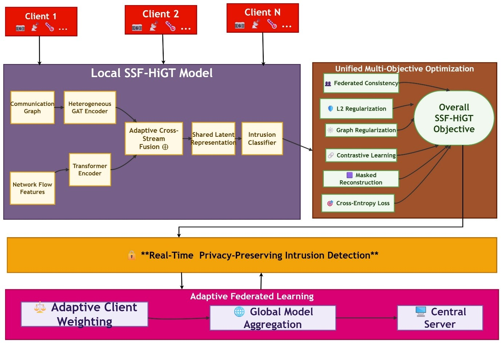

# SSF-HiGT

**Self-Supervised Federated Hybrid Transformer–GNN Architecture for Real-Time Intrusion Detection in Heterogeneous IoT Networks**

This repository provides a PyTorch / Flower reference implementation of **SSF-HiGT**, a federated intrusion-detection framework that combines:

- A **Transformer encoder** for temporal flow-sequence modelling
- A **heterogeneous Graph Attention Network (GAT)** for inter-device communication topology
- **Self-supervised pre-training** via masked flow reconstruction + topology-aware NT-Xent contrastive loss
- An **adaptive cross-stream gating fusion** module
- **Adaptive cosine-similarity federated aggregation** (replacing FedAvg) to counter client drift under non-IID traffic

It is a from-scratch, paper-faithful implementation intended for research and reproduction purposes. It is **not** the original authors' codebase — no official code release was referenced or available at the time of writing; this is a clean-room implementation of the architecture and equations as described in the paper.

## Architecture


<p align="center">
  
</p>


Training proceeds in two federated phases (see `scripts/run_pretrain.py` and `scripts/run_finetune.py`, mirroring Algorithm 1 in the paper):

1. **Phase I — Self-supervised pre-training**: clients optimize `L_Mask + λ1·L_Contrast` on unlabeled traffic; the server aggregates with adaptive weights.
2. **Phase II — Supervised federated fine-tuning**: the classification head is unfrozen and `L_CE + λ1·L_Mask + λ2·L_Contrast` is jointly optimized.

## Repository layout

```
SSF-HiGT/
├── README.md
├── LICENSE
├── requirements.txt
├── configs/
│   └── default.yaml            # hyperparameters (Table 3 in the paper)
├── src/
│   ├── models/
│   │   ├── transformer_encoder.py   # Eq. (9) encoder E_Θ, decoder D_Θ
│   │   ├── gat_encoder.py           # Eq. (10)-(12) heterogeneous GAT
│   │   ├── fusion.py                # Eq. (15)-(16) adaptive cross-stream gate
│   │   └── ssf_higt.py              # full model f_Θ, Eq. (4)-(5)
│   ├── losses.py                    # Eq. (7)-(9),(13)-(14),(17)-(18) all loss terms
│   ├── federated/
│   │   ├── aggregation.py           # Eq. (19)-(20) adaptive cosine aggregation
│   │   ├── client.py                # Flower NumPyClient wrapper
│   │   └── server.py                # Flower strategy using aggregation.py
│   ├── data/
│   │   ├── dataset.py               # CICIDS-2017 / CIC-IoT-2023 loaders
│   │   └── graph_builder.py         # k-NN communication graph construction
│   └── utils/
│       ├── masking.py               # M_ρ(·) feature masking operator
│       └── metrics.py               # accuracy, F1, FPR, per-class reporting
├── scripts/
│   ├── run_pretrain.py              # Phase I federated simulation entrypoint
│   ├── run_finetune.py              # Phase II federated simulation entrypoint
│   ├── run_centralized_baseline.py  # ablation: w/o Federated row in Table 4
│   └── evaluate.py                  # reproduces Tables 4-7 style reports
├── tests/
│   └── test_shapes.py               # smoke tests for tensor shapes
└── docs/
    └── equations.md                 # equation-to-code mapping reference
```

## Installation

```bash
git clone https://github.com/<your-org>/SSF-HiGT.git
cd SSF-HiGT
python -m venv .venv && source .venv/bin/activate
pip install -r requirements.txt
```

## Data preparation

This repo expects preprocessed flow-feature CSVs from:

- **CICIDS-2017** — Canadian Institute for Cybersecurity [1]
- **CIC-IoT-2023** — Canadian Institute for Cybersecurity [2]

Place cleaned CSVs under `data/cicids2017/` and `data/ciciot2023/` respectively (see `src/data/dataset.py` for the expected column schema), then adjust `configs/default.yaml`.

## Running federated training (simulation)

```bash
# Phase I: self-supervised pre-training across N simulated clients
python scripts/run_pretrain.py --config configs/default.yaml --num_clients 10 --rounds 50

# Phase II: supervised federated fine-tuning
python scripts/run_finetune.py --config configs/default.yaml --num_clients 10 --rounds 50 \
    --init_checkpoint checkpoints/pretrain_final.pt

# Evaluate and reproduce ablation-style tables
python scripts/evaluate.py --checkpoint checkpoints/finetune_final.pt --dataset cicids2017
```

## Hyperparameters

Defaults in `configs/default.yaml` follow Table 3 of the paper (8 attention heads, 6 Transformer layers, 3 GAT layers, d_model=256, masking ratio ρ=0.30, NT-Xent temperature τ=0.07, k-NN=7, 100 federated rounds, 5 local epochs).

## Citing this work

If you use this repository, please cite the original paper this implementation is based on:

```bibtex
@article{ssfhigt2026,
  title   = {Self-Supervised Federated Hybrid Transformer-GNN Architecture for Real-Time Intrusion Detection in Heterogeneous IoT Networks},
  journal = {Preprint},
  year    = {2026}
}
```

## Key references

Full reference list (matching in-text citations `[1]`–`[26]` used in `docs/equations.md`) is in [`docs/references.md`](docs/references.md). Selected foundational works this implementation directly builds on:

- Vaswani et al., *Attention Is All You Need*, NeurIPS 2017 — Transformer encoder backbone.
- Veličković et al., *Graph Attention Networks*, ICLR 2018 — GAT message passing (Eq. 10–12).
- Caville et al., *Anomal-E: A self-supervised network intrusion detection system based on GNNs*, Knowledge-Based Systems 2022 — self-supervised graph IDS baseline.
- Nguyen & Kashef, *TS-IDS: Traffic-aware self-supervised learning for IoT Network Intrusion Detection*, Knowledge-Based Systems 2023.
- Liu et al., *CoLA: Anomaly detection on attributed networks via contrastive self-supervised learning*, IEEE TNNLS 2021 — contrastive objective inspiration.
- Kalakoti et al., *FedXAI: Federated Learning of Explainable AI for deep learning-based intrusion detection in IoT networks*, Computer Networks 2025.
- Wen et al., *IDS-DWKAFL: Dynamic Weighted K-asynchronous Federated Learning for smart grid*, JISA 2025 — strongest published federated baseline compared against.
- Maseer et al., *Benchmarking of ML for anomaly-based IDS in the CICIDS2017 dataset*, IEEE Access 2021 — dataset benchmarking reference.
- Tseng et al., *Multi-class intrusion detection based on transformer for IoT networks using CIC-IoT-2023 dataset*, Future Internet 2024 — CIC-IoT-2023 benchmarking reference.

## License

MIT — see [LICENSE](LICENSE).

## Disclaimer

This is a research reference implementation created from the architectural description and equations published in the associated paper. Reported metrics (accuracy, FPR, latency) in the paper were produced by the original authors' experiments; running this code on your own data splits/hardware will not reproduce those exact numbers without matching their full experimental pipeline.
